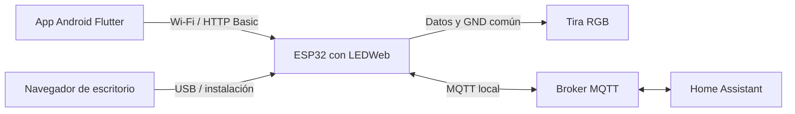

# Arquitectura de Aurora

La app Flutter nativa se conecta por HTTP Basic a cada ESP32 en la LAN. La ESP32 genera los efectos, aplica límites y transiciones, conserva preferencias en NVS, ejecuta horarios y cuenta atrás y mantiene MQTT con Home Assistant. El navegador se usa para instalar por USB o abrir la interfaz alojada en la placa.

Código de app: [rama Aurora](https://github.com/Mortymel/Aurora-RGB/tree/codex/aurora-flutter-android/apps/aurora_flutter). `models.dart` define y valida el protocolo; `device_api.dart` implementa HTTP y demo; `controller.dart` coordina estado, persistencia, sondeo, color en vivo y deshacer; `app_store.dart` usa almacenamiento protegido; `discovery.dart` implementa mDNS; `screens.dart/editors.dart` son widgets nativos y `light_visuals.dart/effect_card.dart/color_wheel.dart` dibujan las vistas.

HTTP: timeout de 8 s, límite de respuesta 64 KiB, sin redirecciones con credenciales y sin reintentos automáticos de escrituras fallidas. Las respuestas de sondeo se comprueban contra dispositivo/revisión para no contaminar otro controlador. La vista en vivo agrupa gestos y envía el último valor con un intervalo de 180 ms, esperando si hay una operación en curso.

Los controladores y preferencias de la app se guardan protegidos en Android; escenas/favoritos pertenecen al teléfono. Horarios, red y política de salida pertenecen a la ESP32. La cuenta atrás vive en RAM de la placa. NVS del firmware no tiene cifrado adicional del proyecto.

Firmware: ledweb/firmware/LEDWeb. La interfaz web es independiente de los widgets Flutter: se empaqueta con ledweb/scripts/build-aurora.cjs como header gzip. Publicación: aurora-flasher.yml compila dos chips y despliega web-flasher/aurora en Pages. El workflow antiguo solo conserva artefactos heredados.

## Flujo de control

La simulación animada de la app es visual: no genera las tramas de la tira real. LEDWeb sigue ejecutando el efecto aunque se cierre Aurora.
